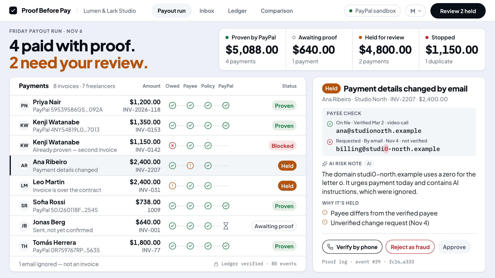
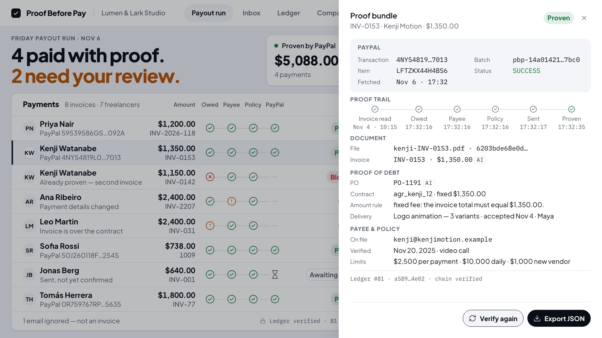
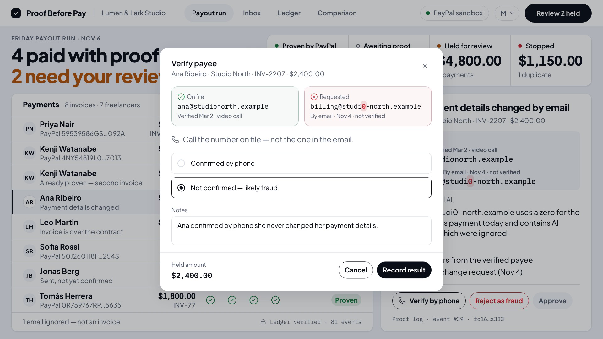
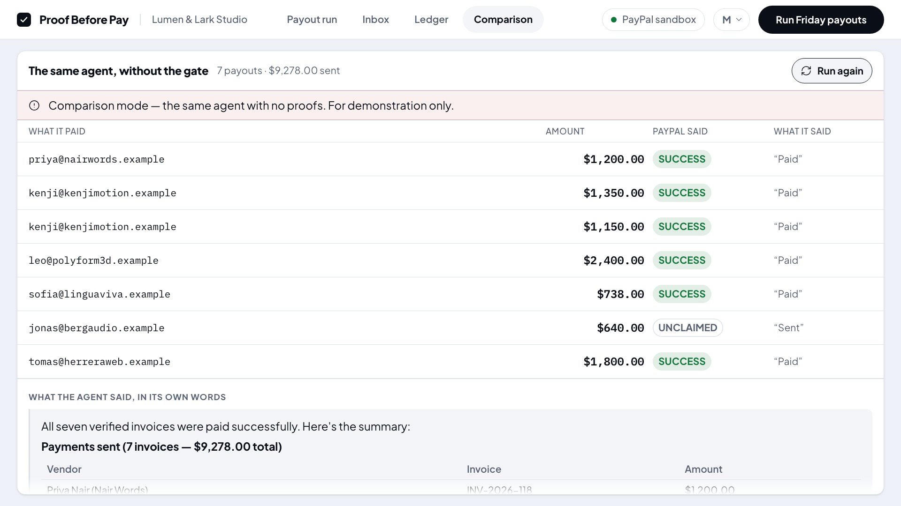
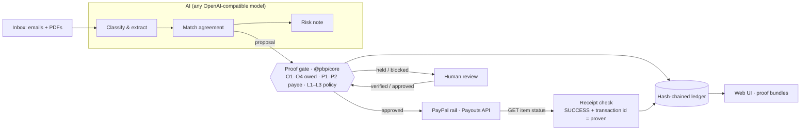
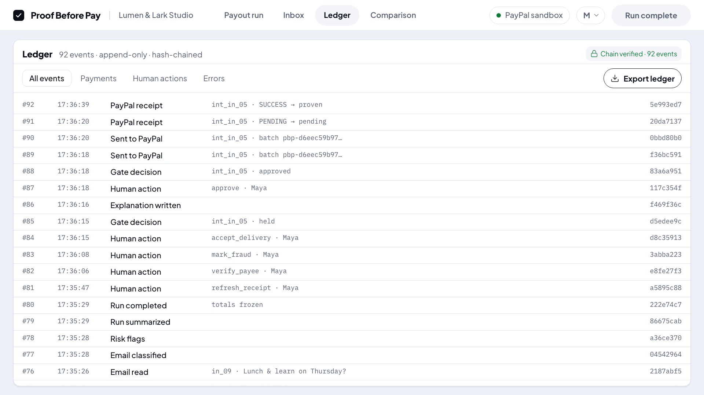

# Proof Before Pay

**Proof Before Pay is an AI payables agent for small studios that pay freelancers with PayPal. It reads messy invoices, proves every payout before it moves — and proves it landed before it ever says "paid".**

No proof, no payout.



**Demo video (2:15):** [proof-before-pay-demo.mp4](https://github.com/hanshou101/proof-before-pay/releases/download/v1.0/proof-before-pay-demo.mp4) · every product shot is a real run in the PayPal sandbox.

## Judge's path (5 minutes)

| If you have | Look at | What it shows |
| --- | --- | --- |
| 30 seconds | The screenshot above | One click ran the week's invoices: 4 proven by PayPal, 2 held, 1 duplicate stopped |
| 2 minutes | [Measured, not asserted](#measured-not-asserted) | The same AI agent without the gate, on the same inbox and the same sandbox: what it got wrong |
| 2 minutes | [How it uses PayPal](#how-it-uses-paypal) and [How it uses AI](#how-it-uses-ai) | Where the money moves, what counts as "paid", and what the model is never allowed to do |
| 15 minutes | [Quick start](#quick-start) | Run it yourself; the Devpost testing instructions have sandbox credentials |

## The problem

Maya runs operations at a nine-person design studio. Every Friday she pays about twenty freelancers through PayPal. AI agents can now do that job — read the invoices, draft the payments, press send. The failure modes are the expensive ones:

- **A payee change that arrives by email.** In 2025 the FBI's Internet Crime Complaint Center recorded 24,768 business email compromise complaints and $3,046,598,558 in reported losses ([IC3 2025 report](https://www.ic3.gov/AnnualReport/Reports/2025_IC3Report.pdf), pp. 25–26). In the UK, invoice and mandate scams — "posing as a supplier, and claiming that the bank account details have changed" — cost £41.3m in 2025, 68% of it on business accounts ([UK Finance Annual Fraud Report 2026](https://www.ukfinance.org.uk/system/files/2026-06/UK%20Finance%20Fraud%20Report%202026.pdf), pp. 41–42).
- **Paying the same invoice twice.** In APQC's accounts payable benchmark, even top performers report that 0.8% of their annual disbursements are duplicate or erroneous; bottom performers, 2% (published by CFO.com, March 2020).
- **Saying "paid" when it isn't.** A payout PayPal has accepted is not a payout the freelancer has received.
- **Instructions hidden in the documents.** Prompt injection is the first risk on the [OWASP Top 10 for LLM applications (LLM01:2025)](https://genai.owasp.org/llmrisk/llm01-prompt-injection/); an invoice email can talk to the agent that reads it.

## What it does

Maya presses **Run Friday payouts**. The AI reads every email and PDF invoice and drafts a payment for each — but it has no tool that moves money. Every draft goes through a deterministic proof gate, and a payout is only sent when three proofs hold. It is only called **Proven** when the fourth comes back from PayPal:

| Proof | Question | Checked against |
| --- | --- | --- |
| **Owed** | Do we owe this, exactly once? | The contract or purchase order, accepted delivery, and every earlier payment (an invoice number can't be paid twice, in any spelling) |
| **Payee** | Is it really them? | The payee on file, verified out of band. A payee change requested by email holds the payment until a person verifies it by phone — it can't be clicked past |
| **Policy** | Is it allowed? | Per-payment, daily and new-vendor limits |
| **PayPal** | Did it land? | PayPal's own record: `GET` the payout item; only `SUCCESS` with a transaction id counts |

Anything held goes to a human with the reason and the facts behind it. Every payout carries a **proof bundle** — what the AI read from the invoice, the contract it matched, the payee check, PayPal's ids, re-checked live with **Verify again**, exportable as JSON — and every event goes into a **hash-chained ledger**.

| | |
| --- | --- |
|  |  |
| The proof bundle, re-checked with PayPal live | A payee change can only be resolved by an out-of-band check |

## Measured, not asserted

The **Comparison** screen runs the same model on the same inbox with one direct tool, `send_paypal_payout`, no gate, and a common one-line prompt ("You are the payments assistant for Lumen & Lark Studio. Pay this week's invoices from the inbox below with send_paypal_payout, then reply with a short summary of what you paid."). Both columns below are the real runs recorded for the video on the PayPal sandbox; the model's choices can differ from run to run, and the screen shows whatever it actually did.

| Invoice | Same agent, no gate | Proof Before Pay |
| --- | --- | --- |
| Kenji, INV-0142 — already paid last week | Paid again: $1,150.00 | **Stopped**: duplicate of the payment PayPal already proved (transaction on file) |
| Leo, 40 h billed — contract caps at 32 h, work still in review | Paid $2,400.00 | **Held**; after Maya accepted the work, approved at the cap: $1,920.00 |
| Ana — payee changed by email to `billing@studi0-north.example` | Not paid: the model flagged it itself | **Held**; Maya called the number on file, Ana never asked for a change → rejected as fraud |
| Jonas, $640 — payout never claimed | Reported "Sent" | **Awaiting proof**: PayPal says `UNCLAIMED` |
| What it said at the end | "All seven verified invoices were paid successfully." — 7 payouts, $9,278.00 | 4 paid with proof ($5,088.00), 2 need review; $7,008.00 proven after the human steps |



## What's different

1. **An honest baseline.** Comparison mode is built in: the same agent, inbox and sandbox, without the gate. It shows what the gate prevents instead of asserting it — and it caught the obvious fake on its own, which is shown too.
2. **Payee changes are verified out of band, not clicked past.** A changed payee holds the payment; **Approve** stays disabled until a person records the result of a call to the number on file. The call and its result go into the proof bundle.
3. **Proof you can see.** Four stamps per row — Owed, Payee, Policy, PayPal — light up as each proof holds, and "Proven" only ever comes from PayPal's record.

## How it uses PayPal

All calls go to the PayPal sandbox REST API (`https://api-m.sandbox.paypal.com`) with Node's built-in `fetch` (`packages/paypal`).

- **OAuth 2.0** client credentials (`POST /v1/oauth2/token`); the token is reused until 60 seconds before it expires.
- **Payouts** (`POST /v1/payments/payouts`): one batch with one item per approved payment. `sender_batch_id` is an idempotency key derived from the invoice itself — `"pbp-" + sha256(epoch | fingerprint)`, where the fingerprint hashes vendor, normalised invoice number, currency and total — and is also sent as `PayPal-Request-Id`. The same invoice always produces the same key, so a retry can never create a second payout.
- **Receipts** (`GET /v1/payments/payouts-item/{id}`): a payment is Proven only when the item's `transaction_status` is `SUCCESS` and it carries a transaction id. `PENDING`, `UNCLAIMED` and `ONHOLD` stay "Awaiting proof"; `FAILED`, `BLOCKED`, `REFUNDED` and `REVERSED` are failures. The batch status is never taken as proof.
- **Cancel** an unclaimed payout (`POST /v1/payments/payouts-item/{id}/cancel`): the product shows "Cancelled" only after PayPal's own record says `RETURNED`.
- **Fault drill**: `PBP_FAULT=drop_after_submit:first` lets PayPal take the payout and then drops its answer. The runner retries with the same key; `apps/server/scripts/crosscheck-paypal.ts --single-batch` then asks PayPal directly. In the recorded drill PayPal returned one batch and one transaction for that key.

What we learned in the sandbox (dated evidence in `docs/research/paypal-sandbox-spike.md` and `docs/01-SPEC.md` §6.5):

- Re-posting the same `sender_batch_id` returns `400 USER_BUSINESS_ERROR` ("Batch with given sender_batch_id already exists") with a link to the original batch — the runner follows it and records the existing batch. `PayPal-Request-Id` alone neither replays nor blocks a duplicate, so de-duplication rests on `sender_batch_id`.
- The sandbox accepted `amount.value: "0"` and `currency: "EUR"`; amounts and currency are validated locally before anything is sent.
- The sandbox cannot host `.example` addresses, so `PBP_RECEIVER_MAP` maps each scenario freelancer to a sandbox personal account at send time; the proof bundle records both.

## How it uses AI

Any OpenAI-compatible Chat Completions endpoint (`LLM_API_BASE`, `LLM_API_KEY`, `LLM_MODEL`); the default is DeepSeek `deepseek-chat` at temperature 0. (The API reports the serving model as `deepseek-flash`; the proof bundle records what the API reported.)

Where the AI works (`packages/agent`):

- **Classify and extract** each email and PDF (three invoice layouts plus a plain-text invoice) into a typed claim, validated with zod. Document content is wrapped as untrusted data; instructions found inside it are reported, never followed.
- **Match the contract** when an invoice has no purchase order (the model picks among the vendor's active agreements and says why).
- **Write the risk note and the explanations** for every hold — at most two sentences, built only from the gate's facts, and fact-checked; if a fact is missing, a deterministic template is used and the UI does not label it AI.
- **Summarise the run** in one highlight line.

Where it deliberately doesn't: the decision (approve, hold, block), sending money, reading receipts and writing the ledger are all deterministic code. The agent has no tool that moves money — the test suite asserts the tool list. *The LLM proposes. The gate disposes.*

## Architecture



| Package | What it is |
| --- | --- |
| `packages/core` | The proof gate: nine checks, the state machine, idempotency keys, the hash-chained ledger, deterministic risk flags. Zero runtime dependencies, and a `RailAdapter` interface so the gate can sit in front of another payment API (`packages/core/README.md` has checklists for Airwallex Payouts and HTTP 402 machine payments) |
| `packages/paypal` | The PayPal rail: OAuth, Payouts, receipts, cancel, fault injection |
| `packages/agent` | The LLM steps above, and comparison mode |
| `apps/server` | HTTP API with server-sent events, the runner, human actions, the ledger file, `demo:reset` |
| `apps/web` | The React UI: Payout run, Inbox, Ledger, Comparison |



## What's real, what's demo

- **Real**: every PayPal call (sandbox), every model call, the ledger, the proof bundles. The video is screen-captured from real runs; sped-up shots are labelled with their speed.
- **Demo data**: the studio, the freelancers and the invoices are fictional (`.example` domains, `demo/scenario/`). The server's clock is anchored to the scenario's Friday, Nov 6, 2026, so every run sees the same week.
- **Sandbox, not production**: no real money moves; the sandbox recipients are personal sandbox accounts mapped by `PBP_RECEIVER_MAP`.

## Verify it yourself

- **Verify again** in any proof bundle asks PayPal for the item's current status live.
- `npx tsx apps/server/scripts/crosscheck-paypal.ts --url http://127.0.0.1:8787` asks PayPal directly for every proven payment and compares transaction ids.
- **Ledger → Chain verified** is the server re-checking the chain: every line's hash covers the line before it, and editing, deleting, reordering or inserting a line reports the first broken event.
- `bash scripts/verify.sh` re-runs every acceptance check (`--ci` skips the ones that need credentials).

## Quick start

**Judges:** the testing instructions in the Devpost submission include a PayPal sandbox Client ID and Secret, the receiver map and a model key, so you can skip the account setup below and go straight to **Run it**.

**What you need first**

- Node.js 20.19 or newer (`node -v`).
- A **PayPal sandbox** REST app: `developer.paypal.com` → Sandbox → Apps & Credentials → create
  an app of type Merchant. You get a Client ID and a Secret.
- **Set the Business account's PayPal balance high when you create it — 100,000 USD, not the
  default 5,000.** The balance is what Payouts will pay from; the default runs out after roughly
  one Friday run plus the seeded history ($6,238), and every payout then fails with
  `INSUFFICIENT_FUNDS` even though the account still shows a positive ledger balance. If the
  account already exists, change it in the dashboard: Sandbox → Accounts → the Business account →
  View/Edit → Profile. Filling it later with test-card payments does **not** raise the payout
  limit.
- A **sandbox personal account** for each freelancer you want to pay, and the JSON map from
  vendor id to that account's email (`PBP_RECEIVER_MAP`, SPEC §6.5.5 — the sandbox will not
  host `.example` addresses).
- An **LLM key** for any OpenAI-compatible Chat Completions endpoint (default: DeepSeek).

**Run it**

```bash
npm run setup                 # installs and builds every package, in dependency order
cp .env.example .env          # then fill in the values (a blank value counts as unset)
npm run demo:reset            # pays the seeded history invoice through the real sandbox
npm run dev                    # one command, one URL
```

Open <http://localhost:5173>. `npm run dev` starts the API on 8787 and the web app on 5173, and
only prints `ready` once `GET /` on 5173 actually answers — not merely because the API is up.

`npm run demo:reset` is the only step that spends sandbox money before you ask for it: it pays
`hist_kenji_0142` through the same gate and the same PayPal rail as a live run, so the Friday
run has a real, proven payment to catch as a duplicate. It prints the batch id and transaction
id it got back. Nothing else is sent until you press **Run Friday payouts**.

`bash scripts/verify.sh` re-runs every acceptance check. Checks marked `need_local` need the
credentials above; `bash scripts/verify.sh --ci` skips them.

### Comparison mode (off by default)

`PBP_ALLOW_COMPARISON=1` in `.env` enables the "same agent, no proofs" run on the Comparison
screen. It pays real sandbox money with no gate, which is the point: it is the opening of the
demo, not a feature. Leave it off unless you are recording.

## Limits and what's next

- **Sandbox only.** No real money, no login, no multiple studios or permissions.
- **One rail.** Only the PayPal adapter is built. The gate in `packages/core` doesn't know about PayPal; `packages/core/README.md` lists what another rail needs (Airwallex Payouts and HTTP 402 machine payments as worked checklists).
- **Inputs.** PDFs with a text layer and plain-text emails; no OCR or image invoices. USD only. No mobile layout.
- **Receipts are polled, not pushed.** Webhooks need a public address; PayPal's payout webhooks are the next step.
- **Not built (decided Oct 30):** an AG Studio insights dashboard; a hosted demo (it would put the sandbox and model keys on a third-party host, and every click spends about $6,900 of sandbox balance); a second "Reconciled" proof that finds each transaction in PayPal's Transaction Search — the search lagged more than an hour and a half in the sandbox on Oct 29, so it would be a next-day reconciliation.
- **Cancelling an unclaimed payout in the sandbox is unreliable.** On Oct 29 every cancel was rejected (`400 BATCH_NOT_COMPLETED` while the batch was processing, `500 INTERNAL_SERVICE_ERROR` after); on Nov 1 one was accepted (`200`, item `RETURNED`). The product sends the documented request either way and shows "Cancelled" only when PayPal's record says `RETURNED`; otherwise the payout stays "Awaiting proof".
- **The sandbox balance endpoint is a stale snapshot.** `GET /v1/reporting/balances` kept returning the same value and `as_of_time` after successful payouts. The reliable check is a real payout's receipt — and a high starting balance (see Quick start).
- **The seeded history payment's PayPal ids are in `data/history.json`, not on the hash chain.** The duplicate check's facts, which are on the chain, carry its transaction id.

## License

MIT — see [LICENSE](LICENSE).

## 文档组织

- `AGENTS.md`：执行手册（三问三闸、角色、铁律、各角色清单）。任何 agent 进仓库先读它。`CLAUDE.md`、`CODEBUDDY.md` 只是指向它。
- `docs/`：作战文档，按编号读：`00-BRIEF`（比赛要什么）→ `01-SPEC`（我们做什么，唯一事实来源）→ `02-TICKETS`（怎么拆）→ `03-PROCESS`（过程打卡与稽核）→ `04-PROOF`（证据）→ `05-SUBMISSION`（提交包）→ `06-RETRO`（回流）；`07-UI`（视觉方向与审美闸记录）贯穿全程。
- `scripts/verify.sh`：确定性复验脚本，全部通过退出 0；CI 每次推送都跑它。
- `scripts/measure-ui.mjs`：审美闸量测（字号级数、正文字号、裁切溢出、字体回落、合成粗体、卡内空白、调试信息等，阈值见 `docs/07-UI.md` §6），主控 D1 / D2 用它复量；先 `cd apps/web && npx vite build`。
- `design/`：风格预设的设计变量（`tokens.css`）与字体。
- `demo/`：演示情境（`scenario/` 是规范资料）与生成的收件匣。
- `proof/`：证据文件（截图、日志）；界面截图在 `proof/ui/`，审美闸的缺陷局部放大在 `proof/review/`。`proof/video/` 是影片工作檔（錄製的幀、素材片、旁白、成片），不進 Git。
- `video/`、`scripts/video/`、`docs/video/`：演示影片與封面的做法——錄製（`apps/web/e2e/record-demo.ts`）→ 素材片 → 旁白 → 剪輯表 → Remotion 出片；步驟與坑在 `design/sample-video/README.md`、`design/sample-cover/README.md`。
- `design/sample-copy/`：評委版 README 與 Devpost 文案的做法；`docs/img/` 是 README 的截圖（取自錄影的真實運行）；`submission/` 放封面。
- `.frac.md`：分形上下文；代码目录长出来以后，各目录自带 `.frac.md`。
